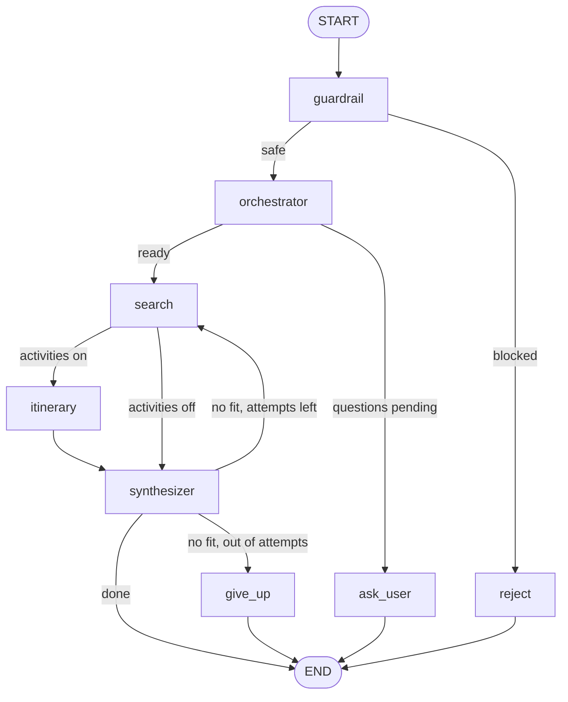

# Multi-Agent Travel Planner

A LangGraph multi-agent system that turns a plain-English trip request into real flight and hotel options, a day-by-day itinerary, and a budget-checked recommendation. It asks clarifying questions when something is ambiguous, blocks unsafe or off-topic input, and runs as a CLI application.

> **Status:** Some features are planned; see [Status and roadmap](#status-and-roadmap).

## What it does

- Understands requests like *"Round trip from San Francisco to Lisbon, Dec 10 to 14, budget $3000, I like museums and food."*
- Asks follow-up questions: ambiguous city names (Richmond, Tripoli), missing dates or budget, one-way vs. round-trip.
- Searches flights and hotels (SerpAPI, Google Flights and Google Hotels) and researches attractions (Tavily).
- Checks the budget in code, retries once with cheapest-first sorting, and explains plainly when nothing fits.
- Supports one-way trips, flights-only requests, and skipping hotels or activities.
- Rejects prompt injection, toxic content, and off-topic input before any paid API call.

## Architecture



Every node reads and writes one shared state object (`state.py`). A node returns only the keys it changed, and LangGraph merges them. Branching is done by small router functions that read the state and return the name of the next step.

| Node | Built from | Job |
|---|---|---|
| `guardrail` | Rules, OpenAI Moderation, LLM classifier | Blocks injection, toxicity, off-topic and oversized input |
| `reject` | Plain code | Turns a block reason into a user-facing message |
| `orchestrator` | LLM extraction plus code checks | Extracts trip details, decides what to ask, resolves airports |
| `search` | SerpAPI tools | Flights (and hotels unless skipped) |
| `itinerary` | Tavily plus LLM | Day-by-day plan (skipped when activities are off) |
| `synthesizer` | Code plus LLM | Budget math and ranking in code; the LLM only writes the final text |
| `ask_user` | Plain code | Formats clarifying questions |
| `give_up` | Plain code | Explains that nothing fit the budget |

Routers: `route_after_guardrail`, `route_after_orchestrator`, `route_after_search`, `route_after_synthesizer`.

## Request flow

1. **Guardrail** checks length, known injection phrases, moderation, and an LLM check for subtler injection and topic.
2. **Orchestrator** extracts structured fields, drops any date the user didn't actually write, defaults to one adult if no travelers are named, and builds a list of questions for anything it can't safely guess. With no questions pending, it resolves and verifies airport codes.
3. **Search** calls Google Flights (one-way or round-trip) and Google Hotels. On a retry it sorts by price.
4. **Itinerary** researches the destination with Tavily and drafts the plan.
5. **Synthesizer** finds flight and hotel combinations within budget, picks the best, and asks the LLM to write it up. If none fit, it loops back to search once, then gives up with an explanation.

## Clarification flow

The system is **stateless**. Asking a question ends the run; the answer is appended to the request text as a labeled line, and the whole graph runs again from the start, so every answer is also passed through the guardrail.

The CLI implements this flow in a loop (`plan_trip` in `main.py`), capped at 3 rounds.

## Safety and reliability

- **Guardrail layers, cheapest first:** length check, regex phrases, OpenAI Moderation, LLM classifier. It fails closed: a check error blocks the request.
- **Dates must be quoted.** The model has to copy the words that gave each date, and code verifies they appear in the request. This stops invented dates.
- **Airports are verified against real data.** The model names the country and an airport code, and code checks both against the `airportsdata` database. A failed guess falls back to choosing from a list of real airports.
- **Code decides, the LLM writes.** Budget math, ranking, traveler defaults, and question text live in code, where they are testable.
- **Bounded loops.** Search retries are capped at 2 passes, and clarification rounds at 3.

## What this project covers

| Concept | Where |
|---|---|
| Multi-agent orchestration (supervisor pattern) | Orchestrator routing work to specialist nodes |
| Stateful graphs with conditional edges and a bounded loop | `graph.py`, the routers, the search retry |
| Structured extraction | `with_structured_output` in the orchestrator, itinerary, and guardrail |
| Tool use | SerpAPI and Tavily wrapped as LangChain tools |
| Human in the loop (stateless variant) | Clarification flow |
| Guardrails and defense in depth | `agents/guardrail.py` |
| Reducing hallucination | Date quoting, airport verification, code-side math |

## Tech stack

| Library or service | Used for |
|---|---|
| LangGraph | The graph, state, and conditional routing |
| LangChain and langchain-openai | LLM calls, tools, structured output |
| OpenAI (`gpt-4o-mini`, Moderation API) | Extraction, writing, classification, toxicity |
| SerpAPI (`google-search-results`) | Google Flights and Google Hotels data |
| Tavily (`langchain-tavily`) | Web research on attractions |
| airportsdata | Verifying airport codes offline |
| python-dotenv | Loading API keys from `.env` |

## Project structure

```text
.
├── main.py              # CLI with the clarification loop
├── planner.py           # Shared core: runs the graph once
├── graph.py             # Builds and wires the LangGraph
├── state.py             # The shared state schema
├── agents/              # guardrail, orchestrator, search, itinerary, synthesizer, exits
├── tools/               # flight_search, hotel_search, web_search
├── utils/               # common helpers
├── requirements.txt
└── .env                 # keys (never committed)
```

## Getting started

Python 3.11 is recommended (this was built and tested on 3.11).

```bash
python3.11 -m venv venv
source venv/bin/activate
pip install -r requirements.txt
```

Create a `.env` file (and commit a `.env.example` with placeholders instead of real keys):

```text
OPENAI_API_KEY=...
TAVILY_API_KEY=...
SERPAPI_API_KEY=...
```

### CLI

```bash
python main.py "One way, flights only, from Chantilly, Virginia to Beirut on December 10, 2026. Budget 1500."
```

## Design decisions

- **Re-run instead of pause-and-resume.** All questions come before any paid search, so a re-run costs two cheap LLM calls. LangGraph's `interrupt` with a checkpointer would suit mid-run questions and is a possible later upgrade.
- **Nodes call tools directly.** Both searches are always needed when they run, so there is no benefit to letting an LLM choose.
- **No MCP.** One app owns all the tools, so a protocol layer would add cost for no benefit.
- **No local transformer models.** The OpenAI Moderation endpoint covers toxicity without a heavy install.

## Status and roadmap

| Feature | State |
|---|---|
| Guardrail, clarification loop, orchestrator, search, itinerary, synthesizer | Working |
| One-way trips, flights-only, skip hotels or activities | Working |
| Sort flights by price, stops, or duration (flights-only) | Working; only the top flight is shown |
| Travelers' counts and ages | Extracted, but not yet sent to the flight and hotel searches or the itinerary |
| Ranked flight list and booking links (airline vs Expedia, Booking.com) | Planned |
| Automated tests | Not yet; manual scripts only |

## Cost and quota notes

A typical run uses about 2 SerpAPI searches (plus 2 on a retry) and 1 Tavily search. SerpAPI's free tier is 100 searches a month, so run the guardrail and question flows first when testing; they cost no searches.

## Known limitations

- Detecting ambiguous place names depends on the model and can miss a case.
- The airport check is country-level, so a wrong airport inside the right country can pass.
- Only one traveler is searched today, and the budget covers flights and hotel only.
- Prices are snapshots from Google Flights and Hotels through SerpAPI. Nothing is booked.
